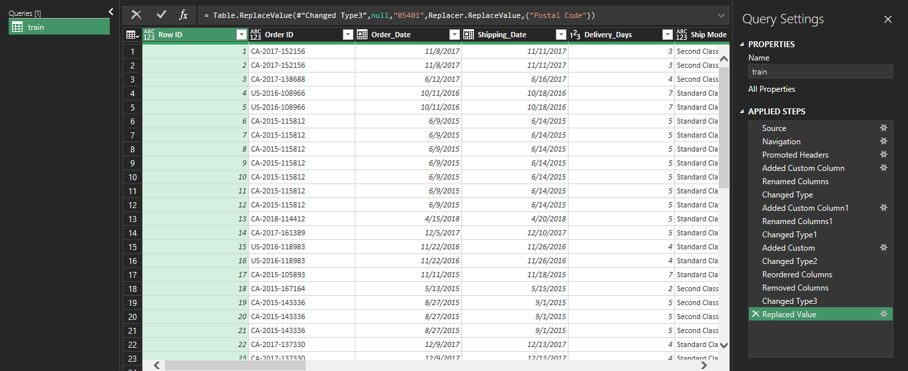
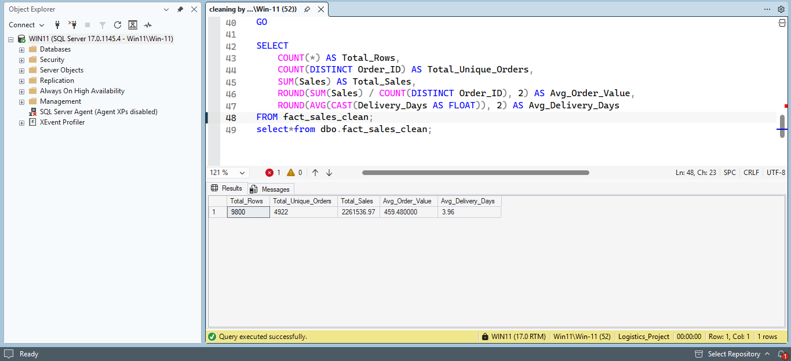
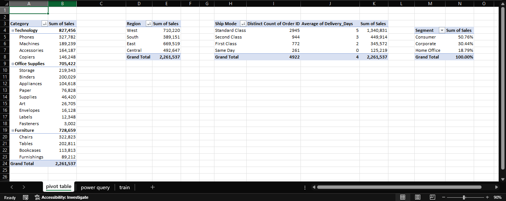
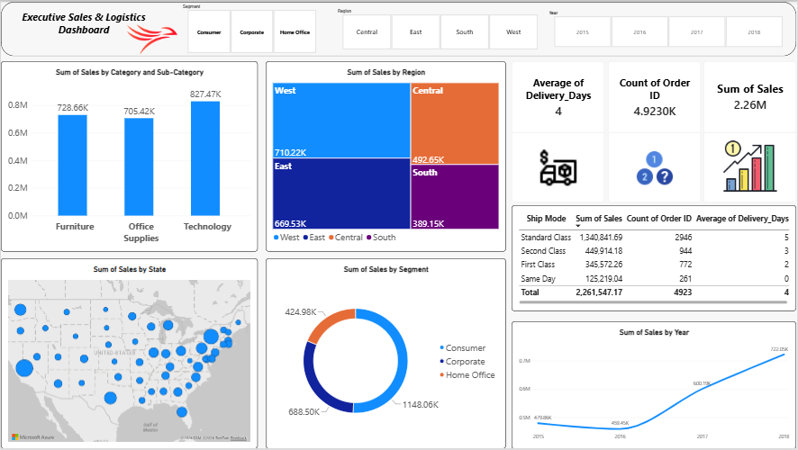

# Superstore Logistics & Order Fulfillment Analytics

## 📌 Project Overview

A comprehensive end-to-end data analysis project focusing on transforming raw retail sales and shipping records (**2015–2018**) into a clean, reliable analytical model. This project demonstrates a full ETL and reporting workflow using **Microsoft Excel (Power Query & Pivot Tables)**, **SQL Server**, and **Microsoft Power BI** to evaluate revenue performance and delivery efficiency across the United States.

## 🛠️ Tools & Technologies Used

* **Microsoft Excel (Power Query & Pivot Tables):** Initial ETL pipeline, date standardization, custom column creation, and exploratory summary tables.
* **SQL Server (T-SQL):** Data type casting, text trimming, null handling, date formatting, and KPI validation queries.
* **Microsoft Power BI:** Interactive data visualization, executive KPI tracking, and logistics performance analysis.

---

## 🧹 Step 1: Data Cleaning & ETL Process (Power Query)

The raw dataset contained formatting anomalies and missing values. An automated ETL pipeline was built in Power Query to ensure data integrity (**9,800 rows** and **4,922 unique orders**):

1. **Date Formatting & Standardization:**
   * **Issue:** `Order Date` and `Ship Date` columns had inconsistent date representations in the raw dataset.
   * **Solution:** Transformed both columns into strict `Date` data types to enable accurate time-series and duration calculations.
2. **Feature Engineering (`Delivery_Days`):**
   * Computed exact order fulfillment time by subtracting `Order Date` from `Ship Date` (`[Ship Date] - [Order Date]`).
3. **Null & Duplicate Handling:**
   * Replaced missing `Postal Code` records with valid text indicators and removed extra/duplicate rows.

### 📸 Power Query Cleaning & Custom Columns Screenshot:


---

## 🗄️ Step 2: SQL Data Transformation & KPI Validation

To ensure database-level reproducibility, the raw staging table (`stg_Superstore`) was cleaned and loaded into an analytical fact table (`fact_sales_clean`) in SQL Server:

* **Type Casting:** Converted `Row_ID` to `INT` and `Sales` to `DECIMAL(18,2)` for financial precision.
* **Date Conversion:** Standardized dates using `CONVERT(DATE, ..., 105)` and calculated `Delivery_Days` via `DATEDIFF`.
* **String Sanitization:** Applied `TRIM()` across all text attributes (`Order_ID`, `Ship_Mode`, `Customer_Name`, `Region`, `Category`, etc.).
* **Null Management:** Handled missing postal codes using `ISNULL(CAST([Postal_Code] AS VARCHAR(10)), 'N/A')`.

```sql
-- Validating Core Business KPIs in SQL Server
SELECT 
    COUNT(*) AS Total_Rows,
    COUNT(DISTINCT Order_ID) AS Total_Unique_Orders,
    SUM(Sales) AS Total_Sales,
    ROUND(SUM(Sales) / COUNT(DISTINCT Order_ID), 2) AS Avg_Order_Value,
    ROUND(AVG(CAST(Delivery_Days AS FLOAT)), 2) AS Avg_Delivery_Days
FROM fact_sales_clean;
```

### 📸 SQL Query & KPI Validation Output Screenshot:


---

## 📈 Step 3: Exploratory Analysis (Excel Pivot Tables)

Before building the final dashboard, the cleaned dataset was explored using Excel Pivot Tables to cross-check totals across key business dimensions:

* **Sales by Category & Sub-Category:** Comparing revenue distribution across Technology, Furniture, and Office Supplies.
* **Regional Revenue Breakdown:** Evaluating total sales across West, East, Central, and South regions.
* **Shipping Mode Volume:** Analyzing revenue and order distribution across Standard, Second, First Class, and Same Day shipping.

### 📸 Excel Pivot Tables Analysis Screenshot:


---

## 📊 Step 4: Power BI Dashboard & Key Business Insights

### 📸 Interactive Power BI Dashboard Screenshot:


### Executive KPIs

* **Total Revenue:** \$2,261,536.78 (\~$2.26M)
* **Total Unique Orders:** 4,922 Orders
* **Total Items Sold:** 9,800 Line Items
* **Average Order Value (AOV):** \$459.48
* **Average Delivery Duration:** 3.96 Days

### Key Analytical Findings

1. **Product Category Performance:**
   * **Technology** leads revenue generation (**\$827K+**), followed by **Furniture** (**\$728K+**) and **Office Supplies** (**\$705K+**).
   * **Phones** and **Chairs** are the top two revenue-driving sub-categories.
2. **Geographical & Segment Distribution:**
   * **West** (**\$710K+**) and **East** (**\$669K+**) regions contribute the highest share of total sales.
   * The **Consumer** segment accounts for **\~51%** of total revenue (\$1.15M), followed by **Corporate** (**\~30%**) and **Home Office** (**\~19%**).
3. **Multi-Year Growth Trend:**
   * Revenue grew substantially from **\$479.9K** in 2015 to a peak of **\$722.1K** in 2018, with strong year-over-year acceleration in 2017 and 2018.
4. **Logistics & Shipping Efficiency:**
   * **Standard Class** handles **\~60%** of all orders with an average delivery time of **5.01 days**.
   * **Second Class** (\~19.5% of orders) averages **3.25 days**, **First Class** (\~15.4%) averages **2.18 days**, and **Same Day** (\~5.4%) fulfills orders within **0.04 days**.

---

## 📂 Repository Structure

```text
├── Data/
│   └── Retail & Logistics Analysis.xlsx          # Raw dataset, Power Query table, and Pivot Tables
├── SQL/
│   └── cleaning by sql.sql                       # SQL Server script for ETL and KPI validation
├── Dashboard/
│   └── Sales & Delivery Logistics Analytics.pbix # Interactive Power BI report
├── images/
│   ├── power_query_cleaning.png                  # Step 1: Power Query screenshot
│   ├── sql_cleaning.png                          # Step 2: SQL KPI results screenshot
│   ├── pivot_tables.png                          # Step 3: Excel Pivot Tables screenshot
│   └── dashboard_preview.png                     # Step 4: Power BI Dashboard screenshot
└── README.md                                     # Project documentation
```
